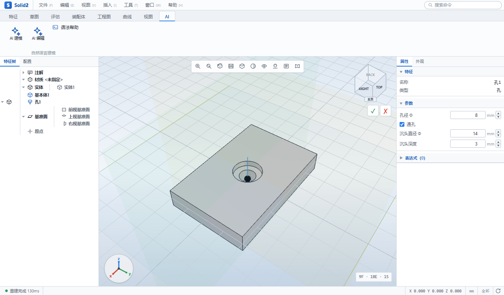
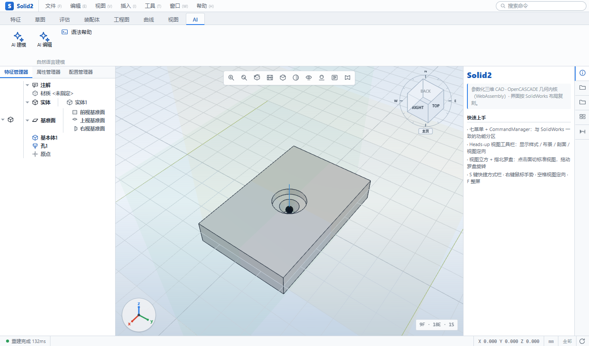
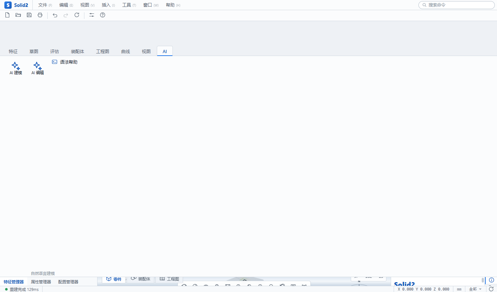

# Solid2 — Web 参数化三维 CAD

[](LICENSE)
[](https://www.typescriptlang.org/)
[](https://threejs.org/)
[](https://github.com/donalffons/opencascade.js)
[](#桌面版windows-免安装-exe)
[](#测试与类型检查)

仿 SolidWorks 的浏览器端参数化 CAD，几何内核使用 **OpenCASCADE (OCCT) 的 WebAssembly 构建**
（`opencascade.js`，工业级 B-rep 精确布尔/圆角/STEP 读写，非 CSG 网格近似）。

技术栈：Vite + TypeScript + three.js + opencascade.js。

## 目录

- [亮点](#亮点)
- [界面截图](#界面截图)
- [快速开始](#快速开始)
- [目录结构](#目录结构)
- [开发](#开发)
- [测试与类型检查](#测试与类型检查)
  - [浏览器端到端冒烟测试](#浏览器端到端冒烟测试)
  - [全功能自动巡演录像（MP4）](#全功能自动巡演录像mp4)
- [桌面版（Windows 免安装 exe）](#桌面版windows-免安装-exe)
- [已知限制](#已知限制)
- [贡献指南](#贡献指南)
- [许可证](#许可证)
- [致谢](#致谢)

## 界面截图

| 界面 | 说明 |
|------|------|
|  | 复刻 SolidWorks 的外壳：七菜单 + CommandManager Ribbon + 特征管理器 + 属性管理器 + ViewCube + 参考三重轴 + 确认角 + 状态栏 |
|  | 任务窗格内置「快速上手」，界面对照 SolidWorks 布局（显示式 / 布景 / 剖面 / 视图定向） |
|  | 80×60×20 底板 + φ8 通孔 + 柱形沉头孔的特征树，图形区带 3D 标记与智能捕捉 |
|  | 菜单栏下方一行：新建 / 打开 / 保存 / 打印 · 撤销 / 重做 / 重建 · 选项 / 帮助 |

## 亮点

- **AI 建模助手（自然语言 → 参数化特征树）**：一句话描述零件，自动解析成特征并建模。
  例如「`60x40x10 的长方体，中心开半径 8 的通孔，四角倒圆角 R5`」→ 直接生成 3 个特征的可编辑特征树。
  - **分层架构，两层各自独立可测**：`文本 →(解析层)→ AiOp[] →(编译层)→ Feature[]`。
    解析层（`src/ai/parse.ts`）产出与内核无关的「意图」，编译层（`src/ai/compile.ts`）把意图落成文档特征。
    两层都是**纯计算、零依赖**（不 import OCCT / three），所以主线程与 Node 单测都能跑。
  - **解析层**：归一化（全角→半角、乘号/直径符号统一、小写）→ 按标点与连接词切子句 → 最长匹配扫关键词
    → 按「数字前紧邻的角色词」给数字归类（长/宽/高/半径/直径/深/边），并单独识别 `60x40x10` 连乘写法。
    支持 5 种基本体、孔（通孔/盲孔/柱形沉头/锥形埋头/螺纹）、圆角/倒角（四角/顶面/全部棱）、抽壳、
    线性/圆周阵列、**弹簧**（中径/线径/螺距/圈数，可左旋、带锥度）、
    **涡状线**（起始半径/螺距/圈数/带厚/带宽，可左旋）、**整体或非均匀缩放**、**镜像**（前视/右视/上视基准面）、
    **拔模**（侧面倾斜给定角度，可反向）、**多实体编辑**（移动/复制实体、删除实体、组合），
    布尔三态（新建/添加/切除/相交）、相对摆放（中心/上面/右边…）、单位（mm/cm/m/in）。
    读不懂的子句进 `issues` 并给出可操作提示，**不静默丢弃**。
  - **编译层维护解析式包围盒**：引擎的基本体约定是「角在原点、沿 +Z 生长」，直接拼装会得到一堆挤在第一象限的重叠体。
    编译层统一给每个基本体算「居中到原点的 origin 偏移」，再按 `place` 相对**当前累计包围盒**平移——
    于是「圆柱上面加一个圆柱」能自然落到位，「中心开孔」也能算准孔位。
  - **长方体有解析式几何引用**：12 条棱、6 个面都有闭式坐标，所以圆角/倒角/抽壳不需要先有模型就能构造引用
    （「四角倒圆角」= 4 条竖直棱，「顶面抽壳」= 顶面 FaceRef）；非长方体时给出明确报错而不是丢一个必失败的引用。
  - **异型孔**：`中心开Φ8的沉头孔，沉头直径14深3` → 柱形沉头孔；`埋头孔` → 锥形埋头孔；`螺纹孔` → 螺纹孔。
    「沉头直径14深6」这类**孔细节子句**会被回填到上一个孔上（不必挤在一句话里），
    且沉头/埋头直径 ≤ 孔径时会**提前拦下**并给出明确报错，而不是丢给内核做不出台阶。
  - **弹簧**：`中径20线径2螺距5圈数10的弹簧`（也可用「外径+线径」，中径自动 = 外径 − 线径），
    支持 `左旋`、`锥度15`；轴向固定 +Z，无先验实体时轴起点在原点、有先验实体时坐在其顶面。
    编译层按「外径 = 中径 + 线径、高 = 螺距×圈数 + 线径」解析式给出包围盒，供后续特征落位。
  - **涡状线**（涡卷弹簧 / 发条）：`涡状线起始半径12螺距6圈数4厚度2.5宽度5`（可加 `左旋`），
    编译层按「外轮廓半径 = 起始半径 + 螺距×圈数 + 带厚/2、法向厚 = 带宽」解析式给出包围盒。
  - **变换三件套**：
    - **缩放**：`整体放大1.5倍` / `缩小一半` / `缩放2倍` / `放大到3倍` / `沿X放大2倍`（非均匀），
      以**当前模型包围盒中心**为不动点；缩放后的长方体仍是长方体，解析式棱引用继续有效
      （于是 `…放大2倍，四角倒圆角R2` 照样能跑）。
    - **镜像**：`沿右视基准面镜像`（默认右视，可写 `前视` / `上视`），以「模型自己的原点」为基准面位置
      （新建模式下即世界原点，追加模式下取现有模型包围盒中心），种子是**上一个特征**；
      包围盒按 `cur ∪ mirror(cur)` 解析式更新。
    - **拔模**：`侧面拔模5度` / `拔模角3度` / `拔模3度，反向`；中性面取长方体底面、拔模面取 4 个侧面，
      都是解析式算出来的 FaceRef（不需要先有模型）。拔模后侧面已倾斜，解析式棱引用会**主动失效**，
      因此「先倒圆角再拔模」可行，「先拔模再倒圆角」会给出明确提示。
  - **多实体编辑**（对标 SolidWorks「移动/复制实体 · 删除实体 · 组合」）：
    - **移动/复制**：`整体沿Z移动50` / `整体向右移动20` / `绕Z轴旋转90度` / `绕X轴逆时针旋转30度` /
      `复制一份沿X偏移30`。作用于**全部实体**；旋转轴过「当前模型包围盒中心」，顺序固定**先转后移**（与引擎一致）。
      包围盒用 8 个角点绕轴旋转求精确解 —— 长方体绕轴向对齐的轴旋转后仍是长方体，所以这不是保守估计。
    - **删除实体**：`删除最后一个实体` / `删除第2个实体` / `删掉第一个实体`。**负数下标**（-1 = 最后一个）
      因为 `bodiesOf` 的展开顺序由拓扑决定，「最后一个」比「第 2 个」可靠得多。
    - **组合**：`把两个实体合并` / `把两个实体相减` / `把两个实体的交集取出来`。主体固定取第一个实体、
      工具体为其余全部（引擎侧把空 `toolIndices` 解析成「所有其它实体」）。
    - ⚠️ **「删除实体」与「删除孔 / 圆角」是两回事**：只有带「实体」二字才走多实体逻辑，
      `删掉孔` 依然是删特征 —— 这条由 `parseBodyOp` 在动作词判定**之前**拦截保证。
  - **几何结果与解析解逐位吻合**（`tools/ai-shape-test.ts`）：长方体 −Φ16 通孔 = 21989.38，
    四角圆角 R5 = 23785.40，顶面抽壳 3 = 28068.00，柱形沉头孔 = 23186.33，锥形埋头孔 = 23409.38，
    弹簧 ≈ πr²·螺旋长；缩放 2× = 64000、镜像 = 13570.80、涡状线 = 带材多边形面积×宽度 = 7501.60、
    拔模 5° = `W·D·H + (W+D)·t·H² + 4/3·t²·H³` = 24885.09；
    多实体：绕 Z 转 90° 的 X/Y 尺寸互换（80×60 → 60×80）、两块相交 20³ 并集 = 12000 / 差集 = 4000 / 交集 = 4000、
    平移后四角圆角 R2 = 7931.33 —— 都是**精确 B-rep 体积**，不是网格近似。
  - **AI 编辑现有模型**（`src/ai/edit.ts`）：在已有特征树上继续用中文「追加 / 改尺寸 / 删除」，
    一句话可含多个动作：
    - 追加：`上面加一个半径8高12的圆柱`、`中心开半径8的通孔`、`四角倒圆角R3`；
    - 改尺寸：`把高改成20`、`把直径改成12`、`把长改成80`、`把长方体改成80x60x20`；
    - 指定对象：`把长方体的高改成20`、`把孔的直径改为6`、`把最后一个圆角改成R3`；
    - 删除：`删掉孔`、`删掉圆角`、`删掉最后一个倒角`（删除后自动**剪掉悬空引用**，
      如阵列的种子特征被删时阵列一并移除，不留注定求值失败的特征）；
    - 无主语的改尺寸按「谁支持这个角色」智能选目标——`把高改成20` 改的是那块**板**而不是板上的孔；
      刚追加过特征时优先改刚加的那个，于是 `再加一个半径8高12的圆柱，把高改成20` 也说得通。
    - **依赖特征会跟着新尺寸走**：板变厚时，它上面的通孔自动移到新顶面（仍是通孔）、圆角/倒角引用重新算到新角点、
      抽壳开口面跟到新面、叠在顶面的凸台整体抬升同样的增量 —— 几何验证里这些编辑后的体积与解析解逐位吻合。
  - **后端可插拔**：解析后端收敛到 `ModelProvider` 接口（`src/ai/types.ts`）。
    当前内置 `localProvider`（本地规则解析，离线可用、零依赖）；
    云端大模型后端只需实现同一接口、吐出同样的 `AiOp[]`，**编译层与 UI 一行都不用改**。
    该分支的云服务环境（WorkBuddy Cloud Service 免密钥 LLM）在开通时会返回
    `云服务资源紧张，请稍后再试`，因此本版本先落地离线规则解析版，云端 provider 待环境就绪后接入。
- **真 B-rep 内核**：精确布尔、圆角/倒角、变半径圆角、抽壳、放样、扫描、旋转、阵列、镜像、异型孔向导、参考基准面、**拔模、筋、弹簧、涡状线、曲面特征（拉伸曲面/旋转曲面/平面区域/放样曲面/扫描曲面/裁剪曲面/缝合曲面）、拉伸终止条件（给定深度/成形到顶点/成形到面/完全贯穿/两侧对称/起始等距/方向2）、薄壁特征（单向/两侧对称/两侧不对称，开环成带、闭环成环带，**拉伸/旋转/扫描三处通用**）**。
- **界面与热键对标 SolidWorks**：CommandManager 右键页签可显隐/折叠（双击页签折叠，记忆到本机）；
  热键按 SW 默认映射且**支持自定义重映射**（工具 → 自定义 → 键盘，捕获式录入、冲突检测、逐项/全部恢复默认，
  覆盖存本机，菜单文本与分发同一份数据）；**Enter 重复上一命令**；状态栏带模式上下文徽标
  （零件 / 正在编辑：草图N / 装配体 / 工程图）。
- **曲线族特征（弹簧 / 涡状线）**：螺旋弹簧由「圆截面沿螺旋线逐站放样」生成（`src/sketch/curve.ts` 纯数学计算螺旋点列 +
  平行移动标架，主线程对话框可直接复用），实测体积与解析式 `πr²·√((2πR)²+pitch²)·n` 吻合到 0.1%；
  支持左/右旋、锥度、任意轴向、布尔加减。涡状线（涡卷弹簧 / 发条）用阿基米德螺线加厚成闭合带材再沿法向拉伸。
- **弹簧的两个关键工程优化**（都带性能回归护栏）：
  1. **周期性快路径**：`ThruSections` 的代价随截面数近似**平方**增长（8 圈 193 截面要 ~50 s，且偶发失败要靠抽稀兜底）。
     而螺旋线是周期结构——第 k 圈恰是第 0 圈绕轴旋转 2πk 并沿轴平移 k·螺距，于是只放样**一圈**再刚体复制，
     合成复合体（本绑定下 `Fuse` 对共面端盖要 20 s+，不可用）。**8 圈求值 ~50 s → 81 ms**，体积精度不变。
  2. **截面缝合点对齐**：`gp_Ax2(P, N)` 的 X 轴按法向自动推导，相邻截面法向略异时 X 轴会跳变、各截面的"缝"彼此错位，
     `ThruSections` 为了迁就它会把本应整片的侧面**切成十几片**（实测单圈 24 截面 = 12 面 / 30 边）。
     沿路径用平行移动标架把缝搬连续后，每圈回到 **3 面**（1 侧面 + 2 端盖），
     网格 2.6×、质量属性 **15×** 提速，整个弹簧重建 567 ms → 164 ms。
- **扫描支持开放路径**：路径草图可以是**开放折线 / 线+弧串 / 纯圆弧 / 闭环**（旧实现只认闭环，开放路径直接报错）；
  采用「平行移动标架 + 逐站截面放样」替代本绑定下失效的 `MakePipe`，纯圆弧路径体积精度 99.96%。
- **内核跑在 Web Worker**：主线程永不 `import opencascade`、不持有任何 `TopoDS` 句柄；
  只消费可序列化的 `MeshResult`（`ArrayBuffer` 零拷贝转移）。内核崩溃被隔离，界面不卡顿
  （`npm run verify:bundle` 校验该不变量）。
- **懒加载**：界面先出（不依赖内核），后台流式下载 63MB WASM 并显示真实字节进度。
- **参数化特征树 + 几何命名引用**：边/面引用用「中点+方向 / 质心+法向」记录，重建时在最新拓扑里就近匹配，
  参数小幅变化时引用稳定。
- **表达式 / 参数化公式（参考 FreeCAD Expressions）**：任意数值参数都能写成以 `=` 开头的公式，
  引用**全局命名参数**或其他**特征的属性**，改一处、整棵特征树自动重算。
  - 完整表达式引擎（`src/doc/expr.ts`，纯计算、零依赖）：`tokenize → Pratt 解析 → 求值`。
    支持 `+ - * / % ^`（`^` 右结合、优先级高于一元负号：`-2^2 = -4`）、比较与逻辑（`and/or/not`，也接受 `&&`/`||`）、
    `sin/cos/atan2/sqrt/pow/min/max/avg/round/...` 等函数、`pi`/`e` 常量。
  - **引用**：裸标识符 → 全局参数；`特征名.属性键` → 其他特征的数值参数（如 `拉伸1.distance`）；
    `特征名.属性键[下标]` → 数组元素（如 `长方体1.dims[0]`）。
  - **单位后缀**（紧贴数字）：`10mm` / `2in` / `1rad` / `30deg` / `45°`，长度归一到 mm、角度归一到度。
  - **依赖图 + 环检测**：参数之间、参数与特征属性之间可以任意串联，惰性求值并检测循环引用；
    出错时**保留字面值**并回写到特征（特征树标红），不会让模型崩掉。
  - **主线程求值**：`App.resolvedFeatures()` 在把特征发给内核前把表达式替换成具体数值，
    因此内核协议与几何代码完全不需要知道表达式的存在；装配体组件也同样先解析。
  - UI：**参数表**对话框（增删参数、实时预览、点击插入可用引用）与**表达式**对话框（给当前特征的某个参数绑定公式）；
    属性面板显示每个特征的表达式绑定与计算值。
- **草图高级曲线族（对标 FreeCAD Sketcher 的曲线工具组）**：在椭圆之外补齐**抛物线、双曲线、B 样条**：
  - **抛物线**：顶点 + 焦距 `focal` + 对称轴方向 `rot` + 参数范围 `[t0, t1]`。
    参数方程 `X(t) = t²/(4·focal)`、`Y(t) = t` —— **与 OCCT `Geom_Parabola::D0(U)` 完全一致**，
    所以实体的参数范围可以原样交给 `Geom_TrimmedCurve`，预览折线与实际边严格同形。
    由「顶点 → 焦点 → 开口范围」三次点击生成；抛物线 + 弦围成的面积解析解为 `T³/(3f)`（实测精确吻合）。
  - **双曲线**：中心 + 实半轴 `a` + 虚半轴 `b` + 实轴方向 `rot`，参数方程 `X = a·cosh t`、`Y = b·sinh t`（**只取右支**）。
    由「中心 → 实轴端点 → 虚轴距离」三次点击生成；与弦围成的面积解析解为 `a·b·(sinh(2T)/2 − T)`（实测精确吻合）。
  - **B 样条**：**通过点（插值）**表示 —— 用户连续点击一串点，曲线**严格穿过每一个点**。
    控制点由 `src/sketch/curve.ts` 的**全局曲线插值**（Piegl & Tiller A9.1：弦长参数化 → 平均技术节点向量 →
    解 `N·P = Q` 线性方程组）算出，再用 `Geom_BSplineCurve_1(poles, knots, mults, degree)` 精确构造边。
    点数不足自动降次（2 个点 → 一次直线）；末点落回起点附近自动**闭合**，闭合的 B 样条可直接拉伸成体。
    实测：16 点近圆环 B 样条拉伸体积与 `π·R²·h` 相差 **−0.003%**（面是精确 B 样条，不是多边形近似）。
  - **用途**：三种曲线都是**开放曲线实体**（闭合 B 样条除外），因此不像直线/圆弧那样参与草图闭环搜索，
    但可以作为**扫描路径**（`sketchPathPolylines` 已纳入），也可以被「镜像实体」镜像
    （抛物线/双曲线关于轴翻转 `rot → 2θ轴 − θ`，B 样条逐个镜像通过点）。
  - **Handle 陷阱（踩坑记录）**：`BRepBuilderAPI_MakeEdge_24` 与 `Geom_TrimmedCurve` 要的是
    `Handle_Geom_Curve`，而 `Geom_Parabola_2(...)` / `GeomAPI_PointsToBSpline_2(...).Curve()`
    返回的是**具体类型的 handle**，embind **不会**自动向上转型。必须 `.get()` 取裸对象再用
    `new Handle_Geom_Curve_2(obj)` 重新包一层，否则报
    `Expected null or instance of Handle_Geom_Curve, got an instance of Handle_Geom_XXX`。
- **约束草图**：LM 最小二乘求解器，18 种约束 + 自由度分析、过定义检测。
- **草图实体族（对标 SolidWorks）**：在直线 / 矩形 / 圆 / 圆弧 / 多边形之外新增**椭圆、直槽口、点**，并提供**镜像实体**：
  - **椭圆**用精确 OCCT 边（`BRepBuilderAPI_MakeEdge_12(gp_Elips)`；`_8` 只接受 `gp_Circ`，传 `gp_Elips` 会报错），
    长 / 短半轴 `rx` / `ry` 与旋转角 `rot` 都参与约束求解，可被「半径 / 短半轴」尺寸驱动。
  - **直槽口**由「两圆心 + 半径」经纯函数 `slotTemplate` 推出 6 个点 + 2 条直线 + 2 个半圆，切点天然相切；
    整体顺时针绕行 ⇒ **两个端帽 `ccw` 均为 false**（右端帽若写成 true 会向内鼓、面积退化成 `2r·L` 矩形）。面积恒为 `2rL + πr²`。
  - **点**是独立参考点，不参与闭环搜索（不会影响轮廓），可作异型孔向导的孔心或用于标注尺寸。
  - **镜像实体**以选中的一条直线为轴、就地镜像其余选中实体，并翻转手性：圆弧 `ccw` 取反、椭圆 `rot → 2θ轴 − θ`。
- **异型孔向导**：在任意平面放置简单孔/柱形沉头/锥形沉头/螺纹孔（通孔或盲孔），
  孔心支持面内 U/V 偏移或按草图点定位，可被阵列复用。
- **拔模 / 筋**：拔模用 `BRepOffsetAPI_DraftAngle`（中性面 + 角度 + 反向）；筋把草图开口轮廓在面内加厚成薄壁再沿法向拉伸融合。
- **实体编辑族（缩放 / 分割 / 移动复制 / 删除实体 / 组合 / 变半径圆角）**——完整的多实体工作流：
  - **缩放**支持非均匀（各轴独立系数）。用 `BRepBuilderAPI_GTransform` + `gp_GTrsf`——`gp_Trsf` 在 OCCT 里
    **只允许等比缩放**，非均匀会直接抛异常。指定中心作为不动点（平移列取 `center − S·center`）。
  - **分割**用 `BRepAlgoAPI_Splitter` + 按包围盒生成的有限矩形面作工具；可选保留法向正侧/负侧/两侧，
    单侧保留按各子实体的**质心投影符号**筛选；平面没真正切到实体时显式报错，杜绝"静默成功"。
  - **移动/复制实体**：先绕给定轴旋转、再平移（顺序固定「先转后移」）；可**按实体勾选**作用对象，
    勾选「复制」时保留原件并按 i 倍变换生成多份副本。多实体状态统一用「实体集合」表示
    （内核 `bodiesOf` 把单实体/复合体都展开成实体列表），因此移动、删除、组合可以互相衔接。
  - **删除实体**：按下标移除实体；全删、空选、下标越界均显式报错（不允许把模型删空）。
  - **组合**：多实体布尔（添加/减除/共同），未被选中的实体原样保留。
    差集/交集可能把主体整体吃掉——OCCT 此时返回的是**空复合体**（`IsNull()` 仍为 false），
    内核会额外检查实体数，避免静默产出一个"空模型"。
  - **变半径圆角**（SolidWorks 的「变量大小圆角」）沿边从 `r1` 线性过渡到 `r2`，
    `Add_3(r1, r2, edge)` 变半径 / `Add_2(r, edge)` 定半径；测试用「体积必须严格介于两个定半径结果之间」作护栏。
- **布尔操作三态**：`添加`（并集融合）、`切除`（差集）、**`新建实体`**。
  `新建实体` 保留已有实体、把新实体作为**独立实体**追加（`compoundOf`，不做布尔融合）——与 SolidWorks 一致：
  多实体零件里「新建」产生新实体而非并入。因此两个**相交**的「新建实体」仍是 2 个实体、体积相加；
  要合并必须显式选「添加」。（旧实现把 `new` 误当 `fuse`，相交时会被静默合并成一个，与 UI 标签「新建实体」不符。）
- **参考基准面**：基于标准基准面或选中面偏移创建，可直接在其上绘制草图。
- **装配 / 工程图**：配合求解、干涉检查、爆炸视图，配合参考支持**视口可视化拾取**（点选组件面 / 棱边 / 圆边 / 圆柱面，带 3D 标记与智能默认「同心」，两轴参考自动选同心）；
  三视图自动布局、逐点 HLR 隐藏线、交互式尺寸标注、**一键自动标注（总宽高 / 各直线边）**、**尺寸公差（±/上下偏差）与形位公差特征控制框（11 种符号）**、
  **孔位自动标注（中心定位 + 直径）**、**明细表（BOM，装配态按同零件自动合并数量）**。
- **构建优化**：Brotli 预压缩把 63MB WASM 的传输体积降到约 9MB（`npm run build` 自动执行）；
  提供「内核精简构建」流水线（扫描所用 OCCT 符号 → 最小头文件清单，供自定义构建，见 `tools/kernel-build/`）。
- **桌面版（Windows 免安装 exe）**：`npm run desktop:build` 一条命令装配出 `Solid2.exe`（约 200 MB，内含 WASM 内核），
  双击即用、不装 Node、不装浏览器、不联网。全程零外部下载 —— 手工装配 Electron 运行时、
  纯 Python 生成图标、纯标准库改写 PE 资源段写入 exe 图标。详见下文「桌面版」。

## 快速开始

只关心「跑起来看效果」的话，三步就够：

```bash
npm install      # 已用项目级 .npmrc 直连 npmmirror 并关掉失效代理
npm run dev      # 打开 http://127.0.0.1:5173
```

第一次加载会拉取 62 MB 的 OCCT WebAssembly 内核（Worker 线程里加载，主线程不阻塞），
随后就能在图形区里建模。想快速体验建模能力，点 Ribbon 的 **AI 建模** 页签，输入一句话：

```text
60x40x10 的长方体，中心开Φ8的沉头孔，沉头直径14深3，四角倒圆角 R4
```

想要一个双击即用的绿色版可执行文件（不装 Node、不装浏览器、不联网）：

```bash
npm run desktop:build    # → release/Solid2-win32-x64/Solid2.exe
```

## 目录结构

```
src/
  core/     几何内核封装（仅 Worker 侧 import OCCT）
    occt.ts         枚举/变换/去重等薄封装
    solid.ts        基本体/布尔/圆角倒角抽壳/阵列镜像/度量
    mesh.ts         三角剖分、边离散化、特征边筛选
    io.ts           STEP 导入导出（仅 Worker）
    meshexport.ts   STL/OBJ 纯网格导出 + 浏览器文件助手（主线程可用）
    kernel.worker.ts  Worker 入口，独占 OCCT，RPC 处理
    kernel.ts       主线程客户端（KernelClient 门面）
    kernel-types.ts 主线程↔Worker 序列化协议（不 import oc/three）
  doc/      文档模型与求值
    model.ts        纯数据 CadDocument（无 OCCT，主线程可用）
    expr.ts         表达式引擎（tokenize/Pratt/求值/依赖解析，纯计算，主线程可用）
    engine.ts       特征树求值引擎（仅 Worker）
    topo.ts         面/边元数据提取
    types.ts        特征类型定义
  sketch/   约束草图
    types.ts        草图数据模型
    solver.ts       LM 约束求解器
    toShape.ts      草图 → 封闭区域 → 面
    rib.ts          筋：开口轮廓 → 面内加厚封闭多边形（纯 2D 计算）
    curve.ts        曲线族纯数学：螺旋/涡状线点列、草图路径采样、平行移动标架与截面放置
                     以及 **B 样条全局曲线插值**（弦长参数化 + 平均节点向量 + 高斯消元求控制点、
                     De Boor 求值、采样折线）
                     （**不 import OCCT**，主线程对话框与 Worker 引擎共用）
  ai/       AI 建模助手（纯计算，不 import OCCT / three）
    types.ts        AiOp 中间表示 + ModelProvider 接口（后端可插拔）
    parse.ts        本地规则解析：归一化 → 切子句 → 关键词最长匹配 → 角色化取数（离线可用）
    compile.ts      AiOp[] → Feature[]：解析式包围盒定位 + 长方体棱/面引用生成
    edit.ts         编辑现有模型：追加 / 改尺寸 / 删特征 + 依赖特征跟随 + 悬空引用剪枝
    index.ts        门面：interpret(text) → { plan, compiled }、editModel(text, ctx) → 新特征数组
  view/     three.js 视图（viewport / shapeview / sketchview / materials）
  app/      应用控制器（app / sketchMode / assembly / drawing）
  ui/       UI 外壳（ribbon / menubar / featuretree / propertypanel / dialogs / icons ...）
  styles/   主题样式
tools/      测试与一次性脚本
  kernel-build/    内核精简构建：符号扫描 → 最小头文件清单（见其 README）
  tour/scripts.mjs 全功能巡演脚本库（每个脚本一套参数 + 专属场景，运行器默认轮换）
  desktop-verify.mjs 桌面版端到端验证：启动 exe → CDP → 内核就绪 → AI 建模 → 体积对拍
  precompress.mjs  构建产物 brotli/gzip 预压缩
  verify-bundle.mjs 校验"主线程不引用 OCCT"的架构不变量
desktop/    桌面版（Electron）
  main.cjs            主进程 + 只监听 127.0.0.1 随机端口的静态服务器
  build-desktop.mjs   手工装配 → release/Solid2-win32-x64/Solid2.exe + zip
  make-icon.py        纯 Python 光栅化 → icon.png / icon.ico（6 个尺寸，零依赖）
  patch-exe-icon.py   纯标准库改写 PE 资源段，把 ICO 写进 exe（替代 rcedit）
```

## 开发

```bash
npm install            # 已用项目级 .npmrc 直连 npmmirror 并关掉失效代理；如需自定义：npm install --userconfig=.npmrc.noproxy
npm run dev            # 开发服务器 http://127.0.0.1:5173
npm run build          # 生产构建 + 预压缩 + 隔离校验
npm run preview        # 预览构建产物
npm run kernel:scan    # 扫描所用 OCCT 符号 → 精简构建头文件清单
npm run desktop:build  # 打包 Windows 免安装 exe（见下文「桌面版」）
npm run demo:video     # 自动巡演全部功能，录制为 MP4（需本机 Edge/Chrome）
npm run demo:list      # 列出全部巡演脚本
npm run demo:probe     # 只跑各脚本的「专属场景」并断言（不录视频，约 35s）
```

## 测试与类型检查

```bash
npm run typecheck      # tsc --noEmit
npm test               # 依次跑全部测试套件
npm run test:sketch    # 草图求解器 + 椭圆/槽口/镜像 + 抛物线/双曲线/B 样条纯数学（纯计算，快）
npm run test:expr      # 表达式引擎：词法/优先级/函数/单位/引用/环检测（纯计算，快）
npm run test:ai        # AI 建模助手：归一化/关键词/角色化取数/异型孔/弹簧/缩放/镜像/涡状线/拔模/多实体编辑/编译定位/编辑指令/错误边界（纯计算，快）
npm run test:drawing   # 工程图 / 尺寸标注 / 自动标注（纯计算）
npm run test:assembly  # 装配配合求解（纯 three.js）
npm run test:doc       # 文档/特征引擎（需 OCCT）
npm run test:features  # 异型孔 / 基准面 / 拔模 / 筋（需 OCCT）
npm run test:curve     # 曲线族：螺旋/涡状线数学、平行移动标架、弹簧/涡状线/扫描实体（需 OCCT）
npm run test:edit      # 实体编辑：缩放 / 分割 / 移动复制 / 删除实体 / 组合 / 新建实体 / 变半径圆角 / 负数下标 / 空工具体（需 OCCT）
npm run test:shape     # 草图 → 实体：矩形/孔/圆弧 + 椭圆/槽口/草图点 + 闭合 B 样条 / 抛物线 / 双曲线（需 OCCT）
npm run test:ai-shape  # AI 建模助手几何：自然语言 → 特征 → 真几何，体积与解析解对拍（需 OCCT）
npm run test:kernel    # 几何内核封装（需 OCCT）
npm run desktop:verify # 桌面版端到端：启动 exe → CDP → 内核就绪 → AI 建模 → 体积对拍（18 项）
```

测试经 `tools/run-ts.mjs` 用 Vite SSR 把 TS 入口打成 ESM 后交 Node 运行；
Node 侧的 OCCT 加载器在 `tools/oc-loader.mjs`。

### 浏览器端到端冒烟测试

上面所有套件都在 Node 里跑（用同一个 OCCT wasm），覆盖内核与引擎，但覆盖不到
**UI 接线、Worker 启动、WASM 实际加载、渲染管线**。补一层真实浏览器测试：

```bash
npm run dev            # 另开一个终端先起开发服务器
npm run test:browser   # 用 Edge/Chrome 的 CDP 驱动真实浏览器
```

它零依赖（用 Node 内置 `WebSocket` 直连 CDP），做九件事：

1. **UI 接线**（不依赖内核）：校验 Ribbon 页签、「AI」页签（AI 建模/AI 编辑/语法帮助）、「实体编辑」分组、
   草图页签「实体」组（椭圆/槽口/点）、「曲线」组（抛物线/双曲线/B 样条）与「编辑」组（镜像实体），
   特征页签「参数化」组（参数表/表达式），以及缩放/分割等按钮的提示文案与图标 SVG 非空；
   并实际点开「参数表」对话框，校验表达式表格的列头、添加按钮与用法说明都渲染出来了。
2. **端到端（实体编辑）**（真实 Worker 内核）：`长方体 20³ → 缩放 2× → 变半径圆角 2→8 → 分割 → 组合（添加）→ 移动/复制`，
   断言体积守恒（8000 → 64000 → 63753.28 → 63753.28 → 63753.28 → 127506.56）、
   面数（6→6→7→13→12→24）、实体数（1→1→1→2→1→2）。
3. **端到端（草图实体族 / 多实体语义）**（真实 Worker 内核）：`椭圆 a=10 b=5 → 拉伸 10`（体积 π·a·b·h）、
   `直槽口 2rL+πr² → 拉伸 6`、`矩形 + φ12 孔 + 定位点 → 拉伸 8`、镜像实体的圆心/半径校验，
   以及「新建实体」相交时保持 2 个独立实体、体积相加（16000）。
4. **端到端（表达式驱动几何）**（真实 Worker 内核）：全局参数 `板厚=8` 驱动拉伸深度（体积 12000）→
   改 `板厚=20` 几何自动联动（30000）→ 复合公式 `板厚*2 + sqrt(16)`（66000）→
   故意写错引用时特征被标红且退回字面值 → 参数表/表达式随文档序列化往返 → 「表达式」对话框可打开。
5. **端到端（草图高级曲线族）**（真实 Worker 内核）：`16 点近圆环 B 样条（闭合）→ 拉伸 10`
   （体积 ≈ π·20²·10，面是精确 B 样条）→ 抛物线/双曲线（开放曲线）不产生实体且不报错 →
   `圆 r=4 沿 4 点 B 样条路径扫描`成体。
6. **端到端（AI 建模助手）**（真实 Worker 内核）：三句话直接建模并核对体积
   （`长方体`=24000、`长方体+通孔+圆角`=21774.78、`板+倒角+抽壳`< 实心）；
   再走一遍真实 UI：点「AI」页签 → 点「AI 建模」→ 弹窗出现 → 输入框敲入描述并实时解析出摘要 →
   点「应用」→ 弹窗关闭且建出圆柱（体积 ≈ π·10²·20）。
7. **端到端（AI 编辑现有模型）**（真实 Worker 内核）：在长方体上依次 `上面加圆柱`（26412.74）→
   `把高改成20`（50412.74，板变厚 + 凸台抬升）→ `删掉圆柱`（48000）；
   再走一遍真实 UI：点「AI」页签 → 点「AI 编辑」→ 直接进入编辑模式并显示当前特征数 →
   敲入 `中心开半径8的通孔` 并实时解析出「新增」改动 → 点「应用」→ 孔生效（43978.76）。
8. **端到端（AI 异型孔 / 弹簧）**（真实 Worker 内核）：`长方体 + Φ8通孔 + 沉头Φ14深3`（23186.33）、
   `长方体 + Φ8通孔 + 埋头Φ12深3`（23409.38）、`中径20线径2螺距5圈数8的弹簧`（≈ π·r²·螺旋长，1% 内）；
   并验证编辑模式里 `中心开Φ8的沉头孔，沉头直径14深3` 的**孔细节子句回填**能落到特征上。
9. **端到端（AI 变换/曲线 · 多实体编辑）**（真实 Worker 内核）：`整体放大2倍`（64000）、
   `板 + 右侧圆柱 + 右视镜像`（13570.80）、`涡状线`（7501.60）、`侧面拔模5度`（24885.09）；
   多实体：`复制一份沿X偏移10 + 合并`（1 实体 / 12000）、`+ 相减`（4000）、
   `复制一份沿X偏移30 + 删除最后一个实体`（1 实体 / 8000）、`整体沿Z移动50`（体积不变 96000）；
   以及编辑态 `整体沿X移动100，四角倒圆角R2`（3 特征 / 7931.33，包围盒落在 X ∈ [90,110]）。

驱动入口是开发态调试句柄 `window.__solid2`（见 `src/main.ts`，**仅 `import.meta.env.DEV` 下注入**，
生产构建会被 Vite 静态消除，不进产物）。环境变量：`SMOKE_TIMEOUT_MS`（等内核就绪上限）、
`SMOKE_HEADFUL=1`（显示窗口）。

### 全功能自动巡演录像（MP4）

在真实浏览器里把 Solid2 的**全部功能逐项跑一遍**，同时逐帧录屏、编码为 MP4：

```bash
npm run dev            # 另开一个终端先起开发服务器（或让脚本自动拉起）
npm run demo:video     # 自动巡演 + 录制，输出 videos/solid2-all-features.mp4
```

> 录像默认落在 `videos/`（已 gitignore），**不放 `dist/`** —— `npm run build` 会清空 `dist/`，放那儿会被误删。

脚本 `tools/all-features-demo.mjs` 零依赖（Node 内置 `WebSocket` 直连 CDP）。

**每次巡演使用不同的脚本。** 巡演内容全部来自脚本库 `tools/tour/scripts.mjs`，
默认**轮换**：每次运行自动挑一个与上次不同的脚本（上次选择记在 `tools/tour/.last-script.json`），
于是每次录出来的视频都不一样。

```bash
npm run demo:list                 # 列出全部脚本
node tools/all-features-demo.mjs --script flange   # 指定脚本
node tools/all-features-demo.mjs --probe           # 只跑各脚本的专属场景并断言（约 35s，不录视频）
node tools/all-features-demo.mjs --speed 3         # 巡演加速 3×（缩短每步停留，视频更紧凑）
node tools/all-features-demo.mjs --music off       # 不合成背景音乐（默认自动合成）
node tools/all-features-demo.mjs --music my.wav    # 用指定 WAV 作为背景音乐
```

内置 5 个脚本，各自描述「这次演什么」——AI 提示词（建模 / 编辑 / 变换 / **多实体**各一句）、
底板尺寸、工程特征参数、基本体清单、曲线/阵列/缩放/表达式参数，外加 1–2 个**专属场景**（脚本独有的建模片段）：

| id | 主题 | 专属场景 |
|----|------|----------|
| `classic` | 经典全功能 | 组合体（底板 + 4 角凸台 + 中心通孔） |
| `flange` | 法兰 · 端盖 | 法兰盘（Φ140 + 8×沉头孔）、端盖（中心阶梯孔 + 6×均布通孔） |
| `bracket` | 支架 · 筋板 | L 形支架、加强筋板 |
| `spring` | 弹簧 · 曲线 | 双弹簧对（右旋 + 左旋）、锥度弹簧 + 座圈 |
| `fighter` | 喷气战斗机 | 机身（边廓旋转）、后掠主翼、尾翼 + 立尾、座舱盖（4 个渐进场景） |

新脚本只需在 `tools/tour/scripts.mjs` 里加一个对象、写自己关心的字段（其余回落到「经典」值）即可。

已录好的成品：`videos/solid2-tour-<id>.mp4`（各脚本一份，各约 3.5 分钟 / 9 MB）、
`videos/fighter.mp4`（喷气战斗机，3× 加速 + 背景音乐），
`videos/solid2-all-features.mp4` 是最近一次运行（默认轮换）的输出。

**22 个固定步骤**覆盖：界面总览 → AI 建模助手（自然语言建模 + 编辑 + 变换/曲线 + 多实体编辑）→
草图实体族（真实鼠标点击绘制矩形/圆/椭圆/槽口/圆弧/点/多边形 + 镜像）→
草图曲线族（抛物线 / 双曲线 / B 样条 + 闭合 B 样条拉伸成体）→ 约束草图 →
拉伸/切除（SW 式：起始等距 / 给定深度 / 成形到顶点 / 成形到面 / 完全贯穿 / 两侧对称 / 方向2 / 薄壁特征）→ 工程特征（圆角/倒角/变半径圆角/抽壳/拔模/筋/异型孔）→ 五种基本体 → 旋转/放样/扫描（含薄壁：开环成筒、闭环成管）→
阵列（线性/圆周/镜像）→ 实体编辑族（缩放/分割/移动复制/组合/删除/新建实体）→ 参数化（表达式/参数表）→
曲线（弹簧/涡状线）→ 基准面 → 装配体（插入/配合/干涉检查/爆炸）→
工程图（三视图/自动标注/孔位/明细表/PNG 导出）→ 评估（质量属性/测量/统计）→
**曲面（拉伸曲面/旋转曲面/平面区域/放样曲面/扫描曲面/裁剪曲面/缝合曲面，均为不参与实体布尔的壳）** →
视图（显示样式/方向/基准面/网格）→ 文件导出（STEP/STL/OBJ）→ 撤销/重做/重建。
随后是脚本的专属场景，最后收尾环绕与汇总。

每个功能组结束时切换到**等轴测视角并自动取景**（`isoView()`），画面更生动。录制流程：逐帧
`Page.captureScreenshot(jpeg)` 存帧并记录真实时间戳，编码时用 **ffmpeg concat demuxer** 写入每帧实际
`duration` 保持节奏，再统一为 CFR 30fps H.264。**编码后自动混入背景音乐**——`tools/tour/gen_music.py`
用 numpy 合成一段温暖舒缓的 C 大调氛围乐（Pad + 马林巴琶音 + 贝斯 + 钟琴 + 空间延迟），长度取
「视频时长 + 2s」，ffmpeg `-c:v copy -c:a aac -shortest` 只重编音频、不损失画质。
环境变量：`DEMO_W`/`DEMO_H`（默认 1600×900）、`DEMO_SPEED`（速度倍率，同 `--speed`）、
`DEMO_MUSIC`（`auto`/`off`/`<wav>`，同 `--music`）、`DEMO_KEEP_FRAMES=1`（保留抽帧）、
`FFMPEG`（自定义 ffmpeg 路径，默认用 `imageio-ffmpeg` 内置的 7.1）、`PYTHON`（合成音乐用，默认探测项目 venv）。

> 写专属场景时的几何约定：`__D.box/prim` 的 `origin` 是**角点**（不是中心），圆柱/圆锥/圆环底面在
> `origin` 沿 +Z 生长，只有球是中心落位；`__D.cirPattern(...)` **必须**传 `seedFeatureId`（见下文已知限制）。

## 桌面版（Windows 免安装 exe）

把整个 Solid2 打包成一个**双击即用的绿色版 exe**，不装 Node、不装浏览器、不需要联网：

```bash
npm run desktop:build    # 装配 → release/Solid2-win32-x64/Solid2.exe + Solid2-win32-x64.zip
npm run desktop:verify   # 真的启动 exe，走 CDP 端到端验证（18 项断言）
npm run desktop          # 开发态直接跑 Electron 壳（复用 dist/）
```

产物：

| 路径 | 说明 |
|------|------|
| `release/Solid2-win32-x64/` | 绿色目录，整个文件夹可拷到 U 盘 / 别的电脑 |
| `release/Solid2-win32-x64/Solid2.exe` | 主程序，约 200 MB（内含 62 MB WASM 内核） |
| `release/Solid2-win32-x64.zip` | 分发用压缩包，约 133 MB |
| `release/使用说明.txt` | 给最终用户看的说明 |

**为什么要自己装配，而不用 electron-builder？**
electron-builder 的 NSIS / winCodeSign 组件要从 GitHub Releases 下载，本机网络拿不到。
`desktop/build-desktop.mjs` 改走**等价的手工装配**（electron-packager 也是这么干的）：
拿现成的 Electron 运行时 → 删掉 `default_app.asar` → 精简语言包（只留中英文，省 50 个 `.pak`）→
把 `resources/app/{main.cjs, icon.png, package.json, dist/}` 塞进去 → `electron.exe` 改名 —— 全程零外部下载。

**为什么主进程要自带一个静态服务器？**
Solid2 是「ES module + Web Worker + 62 MB WASM」的纯前端应用，用 `file://` 直接打开会踩三个坑：
① ES module 的 `import` 被 CORS 拦；② Worker 无法从 `file://` 加载；③ `fetch()` 读 wasm 被判跨源。
所以 `desktop/main.cjs` 在**只监听 `127.0.0.1` 随机端口**的静态服务器上服务 `dist/`，
窗口 `loadURL` 到它 —— 等价于 `npm run preview`，但用户看不到任何服务器进程。
安全基线：`contextIsolation: true / nodeIntegration: false / sandbox: true`，外部链接一律交给系统浏览器。

**exe 图标怎么来的？** 同样是零外部依赖：`desktop/make-icon.py` 用纯 Python 光栅化
（4× 超采样 + 盒式降采样，等轴测线框立方体）产出 256×256 PNG 与 6 尺寸 ICO；
`desktop/patch-exe-icon.py` 用标准库 `struct` **直接改写 PE 资源段** —— 解析出原有资源树
（版本信息 / 应用清单…）完整保留，只替换 `RT_ICON(3)` + `RT_GROUP_ICON(14)`，
重建后放进一个**新追加的 `.rsrc2` 节**并改数据目录指向它，最后重算 PE 校验和。
（先写临时文件、校验通过才原子替换，失败不会留下坏 exe。）

> 本机验证环境有两个坑，只在 `tools/desktop-verify.mjs` 里规避，**不影响应用本体**：
> shell 里设了 `ELECTRON_RUN_AS_NODE=1`（Electron 会退化成纯 Node，直接退出），
> 以及 GPU 进程起不来（加 `--disable-gpu` 走软件光栅）。真实桌面上用户双击即可。

## 已知限制

- Headless 浏览器加载 65MB WASM 的内存占用偏高，某些容器/CI 环境可能 OOM；
  实测本机 headless Edge 可正常加载并跑通完整端到端（`npm run test:browser`，约 7s）。
- 形位公差的锚点固定取视图中心（引线指向视图中央），暂不支持自由点选位置；尺寸公差通过「尺寸公差」命令设置。
- 筋仅支持单条连续开口轮廓；闭环草图需改用拉伸。
- 扫描的截面过渡是**逐段直纹面**：尖锐折角处会切掉一小角（L 形路径约 −2.9%、线+弧约 −8.4%）；
  直线 / 纯圆弧 / 闭环路径误差 ≤ 3%。根因是本绑定下 `BRepOffsetAPI_MakePipe` / `MakePipeShell`
  对多段弯曲路径算出退化结果（圆弧折线体积直接变 0），只能改用放样近似。
- `BRepOffsetAPI_ThruSections.Build()` 在**某些截面数量**下偶发抛异常（圆截面链 14/16/24/30 段每圈必失败，
  10/12/20/36 段正常），疑为 wasm 侧不稳定；`loftWires` 已内置「平滑 → 直纹 → 逐级抽稀」降级重试。
- **圆周阵列必须指定种子特征**：`circularPattern` 不给 `seedFeatureId` 时，引擎会把「整个当前模型」
  绕轴复制 N 份再 `Fuse`——对轴对称的圆盘等于什么都没做，还会把已经开好的孔**盖回去**（各份互相填补
  对方的孔）。`__D.cirPattern(...)` 因此把种子作为第 6 个参数，专属场景与巡演第 11 步都显式传入。
- `FaceMeta.normal` 是**三角网格法向的面积加权平均**，对闭合曲面（整圆柱侧面 / 球面 / 圆环面）会互相
  抵消而退化；此时回落到该面**最大三角形**的法向（实测数据，圆柱侧面必然是径向）。因此「按
  `normal[2] > 0.9` 挑顶面」还必须同时限定 `surfaceType === 'plane'`，否则 `2h > r` 的圆柱会选中侧面
  （面积 `2πrh > πr²`）。
- 弹簧走周期性快路径时是**复合体**（每圈一个实体），状态栏会显示「N 实体」而非 1。
  本绑定下 `Fuse` 融合共面端盖要 20 s+（逐级降级与 Glue 模式都试过），远不如复合体的 0 ms，
  且复合体的三角化、双向布尔、特征链续算均已实测正常。锥度 / 螺距 ≤ 线径 / 中径 ≤ 线径 时退回整条放样（单实体）。
- 弹簧穿过实体表面的布尔（如螺旋槽）代价偏高：8 圈切圆柱约 12.5 s（对齐缝合点前为 17.5 s），
  瓶颈在布尔本身而非弹簧求值（求值仅 ~0.1 s）。
- 内核精简构建需在有 Docker 的环境执行（`tools/kernel-build/README.md`）；本仓库默认用全量 `opencascade.js` + Brotli 预压缩。
- **OCCT 报错信息会被翻译**：本 wasm 绑定未链接异常解栈符号，某些算子（典型是圆角半径过大）在
  `Build()` 内直接抛 C++ 异常时，JS 侧只能看到一句无意义的 `___cxa_is_pointer_type is not defined`。
  内核层的 `guardOc` 会把它统一翻译成「几何条件不满足（尺寸/半径过大，或与相邻面冲突）」这类可读中文。
  实测这种异常**不会破坏 wasm 运行时状态**（抛错后同实例内新建文档求值、原文档改参数重算全部正常），故无需熔断。
- **`BRepAlgoAPI_Defeaturing`（去除特征）在本绑定下不可用**：方法名是 `AddFaceToRemove` 而非 `AddFace`，
  且即便改对调用后 `IsDone()` 仍恒为 `false`，无法得到结果，故该功能未实现。
- **变半径圆角的半径约束**：`r1`/`r2` 必须小于相邻面的可用宽度；超过时 OCCT 会抛异常（已被翻译为可读中文），
  特征树会标红该特征但**保留上一个成功结果**，不会让整条链变成空。
- **「组合」的面数可能多于预期**：OCCT 的 `Fuse` 不总是把共面片合并成一片——例如「分割成两块再组合（添加）」
  体积能精确复原（63753.28），但面数会是 12 而非原来的 7。几何与度量正确，仅拓扑分片更细，不影响后续特征。
- **区域面积是内接多边形近似**：草图闭环的 `region.area` 用采样多边形计算（用于嵌套/内外判定），
  对含圆弧 / 椭圆的轮廓会略小于精确值（圆约 −0.6%、椭圆约 −0.03%、槽口约 −0.1%）。
  但由该闭环构造出的 **OCCT 面是精确的**（椭圆面积恰为 π·a·b、槽口恰为 2rL + πr²），
  因此拉伸/旋转的体积精确；仅当直接读 `region.area` 时需容忍这一近似。
- **抛物线 / 双曲线是开放曲线实体，不参与草图闭环搜索**：它们不像直线 / 圆弧那样带 `SkPoint` 端点
  （端点位置由参数范围 `t0`/`t1` 派生），因此无法与其它实体连接成环。用途是**扫描路径**与参考几何；
  要做出实体，请把曲线端点用直线手工连接（或在几何层用 `advancedCurveEdge` + 弦自建线框）。
- **桌面版 exe 未做代码签名**：Electron 运行时自带的签名会因改写 PE 资源段而失效，Windows SmartScreen
  首次运行可能提示「未知发布者」——点「更多信息 → 仍要运行」即可。要消除提示需购买代码签名证书。
- **桌面版打包产物不入库**：`release/` 已 gitignore（解压后 345 MB）。`npm run desktop:build` 可随时重建，
  前提是 `node_modules/electron/dist` 存在（首次需 `npm install`）。
  **闭合 B 样条**（末点落回起点附近自动闭合）则自成一环，可以直接拉伸成体。
- **B 样条闭合处的切向**：闭合曲线用「末尾补回起点」实现（首尾点严格重合），
  在起点处的切向由相邻两段决定，**不是**周期 B 样条那样天然 p 阶连续；
  对光滑点集（如近圆环）差异极小，但极端折返的点集会看到轻微折角。
- **AI 助手当前是本地规则解析，不是大模型**：本分支的云服务环境（免密钥 LLM）开通时返回
  「云服务资源紧张，请稍后再试」，因此先落地离线规则解析版——只认既定句式与关键词，
  泛化能力弱于大模型（换个说法可能就解析不出来，此时会在预览区给出「没有识别出实体类型」提示）。
  解析后端已抽象成 `ModelProvider` 接口，云环境就绪后新增一个 provider 即可切换到云端大模型，
  编译层与 UI 无需改动。
- **AI 的圆角 / 倒角 / 抽壳 / 拔模只作用于长方体**：这几类特征需要几何引用（棱 / 面），
  只有长方体的 12 棱 6 面有闭式坐标可以直接算出来。作用在其他形状上时会明确报错，
  而不是丢一个必然失败的引用给引擎。孔则不受此限制（用面中心构造孔平面即可）。
  另外**拔模会让侧面倾斜**，所以拔模之后的解析式棱引用会主动失效——「先倒圆角再拔模」可行，
  「先拔模再倒圆角」会给出提示（需要的话把顺序调过来）。
- **AI 新建模式会替换当前文档**（`生成模型` 先压一次撤销栈，可 `Ctrl+Z` 撤回）；
  要在已有模型上继续改，请切到「编辑当前模型」（或点 Ribbon 的「AI 编辑」）。
- **AI 的线性阵列方向**默认为 X 轴（可写「沿Y」「沿Z」），圆周阵列固定绕 Z 轴、整圈 360°。
- **AI 的弹簧轴向固定为 Z 轴**：无先验实体时轴起点在原点，有先验实体时坐在其顶面中心。
  参数只认「中径 / 外径 + 线径 + 螺距 + 圈数」（可选左旋、锥度），不做任意轴向与自定义起点。
- **AI 的涡状线落在前视基准面**：有先验实体时坐在其顶面中心。参数只认
  「起始半径 / 螺距 / 圈数 / 厚度 / 宽度」（可选左旋），不做任意平面与自定义起点。
- **AI 的缩放以模型包围盒中心为不动点**（不认自定义基点）；「缩小 N 倍」按 `1/N` 理解，
  「缩小到 N 倍」按 `N` 理解。
- **AI 的镜像以「模型自己的原点」为基准面位置**：新建模式下编译层已把实体居中，基准面即世界原点；
  追加模式下取现有模型包围盒中心。种子是**上一个特征**（与文档层 `mirror` 特征语义一致），
  因此「把整个模型镜像一份」要先让模型相对该基准面不对称。
- **AI 的异型孔**：柱形沉头 / 锥形埋头 / 螺纹三种孔型都映射到引擎的孔特征，
  沉头（埋头）深度从放置面起算；沉头/埋头直径必须大于孔径，否则**在编译层直接报错**、不生成孔。
- **AI 的移动 / 复制 / 删除实体作用于「全部实体」**：不做按实体勾选（引擎支持 `indices`，
  但 AI 层不产出）。旋转轴过「当前模型包围盒中心」、只支持轴向对齐的 X/Y/Z 轴。
  旋转后长方体不再轴向对齐，解析式棱引用会**主动失效**（此时 `refBox` 变 null）。
- **AI 的「删除实体」靠负数下标表达「最后一个」**：`bodiesOf` 的展开顺序由**拓扑**决定，
  不保证等于插入顺序，所以 `删除第2个实体` 的下标语义是「按拓扑展开的第 2 个」，
  可能和界面上看到的顺序不一致；`删除最后一个实体`（-1）才是稳妥写法。
- **AI 的组合固定「第一个实体为主体」**：`把两个实体相减` 是「按拓扑展开的第 1 个 − 其余全部」。
  另外两个**分离**实体做并集，OCCT 的 `Fuse` 不会把它们连成一个，结果仍是 2 实体复合体
  （体积守恒，只是没有真正合并成一个体）——要合成一个体需要两个实体实际相交。
- **AI 编辑的依赖跟随是「一段式」的**：改某个基本体尺寸时，只跟踪它**身后到下一个基本体之前**的
  孔 / 圆角 / 倒角 / 抽壳（以及恰好贴在新移动面上的那个后续基本体，并递归处理它自己的依赖），
  不做全局依赖图。手工建的草图 / 拉伸 / 放样等特征不参与跟随。
- **AI 编辑时「去掉 / 去除」按删除理解**（如「去掉圆角」= 删掉圆角），
  要表达布尔切除请用「切除 / 挖掉 / 减去」（如「挖掉一个半径5的圆柱」）。
  新建模式下「去掉」仍是布尔切除，两种语境各取更自然的读法。
- **改尺寸不会自动求解「孔深 > 新板厚」这类约束**：圆角/倒角/壁厚超过新尺寸时只给 `warn` 提示并放行，
  由内核在重建时给出最终判定，不做自动夹取（避免悄悄改掉用户给的数值）。

## 贡献指南

欢迎提 Issue 与 PR——仓库里已经配好了模板，照着填能省去大量来回沟通：

| 想做什么 | 去哪里 |
|----------|--------|
| 报告缺陷 | [New issue → Bug 报告](https://github.com/yyefree/solid2/issues/new/choose) |
| 提功能建议 | [New issue → 功能建议](https://github.com/yyefree/solid2/issues/new/choose) |
| 使用疑问 / 交流 | [Discussions](https://github.com/yyefree/solid2/discussions) |
| 提功能前对照差距 | [`docs/solidworks-comparison.md`](docs/solidworks-comparison.md) |

提交 PR 前建议在本地跑一遍「三连」，这也是流水线会检查的内容：

```bash
npx tsc --noEmit   # 类型干净
npm test           # 19 个套件：草图/表达式/测量几何/AI/工程图/装配体/内核/单位制/截面属性/曲面/拉伸终止条件·薄壁特征/旋转扫描薄壁/热键层…
npm run build      # 生产构建 + 预压缩 + 「主线程不引用 OCCT」架构不变量校验
```

改动落在浏览器交互或几何语义上时，请补对应断言（`tools/*-test.ts` 的体积 / 面数 / 实体数，
或 `npm run test:browser` 的 DOM/端到端检查）——本项目的历史回归大多是「静默产出错误几何」，
一条解析解断言比十行描述更管用。PR 模板里列了完整的自查清单。

## 许可证

本项目采用 [Apache License 2.0](LICENSE) 授权。

这意味着你可以自由地使用、修改、分发本项目的代码（含商业用途），
只需保留原始版权声明与许可证文本，并在修改文件时说明「你改过」。
Apache-2.0 同时提供了显式的专利授权条款。

第三方组件保留其各自许可证：几何内核为
[MIT 许可的 opencascade.js](https://github.com/donalffons/opencascade.js)
（封装的是 LGPL-2.1 的 OpenCASCADE 库），图形层为
[MIT 许可的 three.js](https://github.com/mrdoob/three.js)。

## 致谢

- [OpenCASCADE](https://www.opencascade.com/) —— 工业级开源几何内核，本项目的 B-rep 精确建模能力全部来自它。
- [opencascade.js](https://github.com/donalffons/opencascade.js) —— 把 OCCT 编译成 WebAssembly，使浏览器端获得 STEP 读写与精确布尔。
- [three.js](https://github.com/mrdoob/three.js) —— WebGL 渲染层。
- [SolidWorks](https://www.solidworks.com/) —— 界面与交互设计的对标对象；本项目为学习性质的复刻，与其无任何关联。
